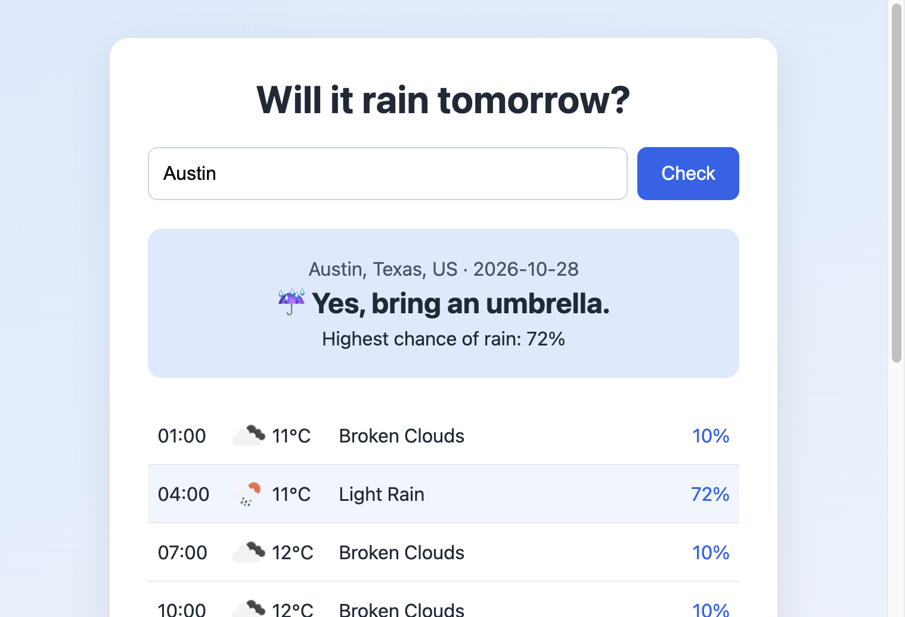

# Will It Rain Tomorrow?

A small Node.js + Express website that tells you whether it will rain tomorrow in any city. It uses the [OpenWeatherMap API](https://openweathermap.org/api), Axios for the HTTP requests, and EJS for the page.



## How it works

1. You type a city into the form. The form sends a GET request to `/weather?city=...`.
2. The server calls the OpenWeatherMap **Geocoding API** to turn the city name into latitude and longitude.
3. The server calls the **5 Day / 3 Hour Forecast API** with those coordinates.
4. It keeps only the forecast entries that fall on *tomorrow* in that city's own timezone.
5. If any of those entries is Rain, Drizzle, or Thunderstorm (or has a rain amount), the answer is "Yes". The page also shows the highest chance of rain and a 3-hour breakdown.

Errors are handled for an empty search, an unknown city, a missing or rejected API key, rate limits, and the weather service being unreachable.

## Setup

You need [Node.js](https://nodejs.org/) and a free OpenWeatherMap API key from [openweathermap.org/api](https://home.openweathermap.org/api_keys). New keys can take up to a couple of hours to start working.

```bash
npm i
cp .env.example .env
```

Open `.env` and replace `paste_your_key_here` with your key.

## Run

```bash
nodemon index.js
```

or, without nodemon:

```bash
node index.js
```

Then open [http://localhost:3000](http://localhost:3000).

## Project structure

```
index.js              Express server, API calls, and rain logic
views/index.ejs       The page (search form, answer, hourly breakdown)
views/partials/       Shared header and footer
public/styles/        CSS
.env.example          Template for your API key (.env itself is not committed)
```
